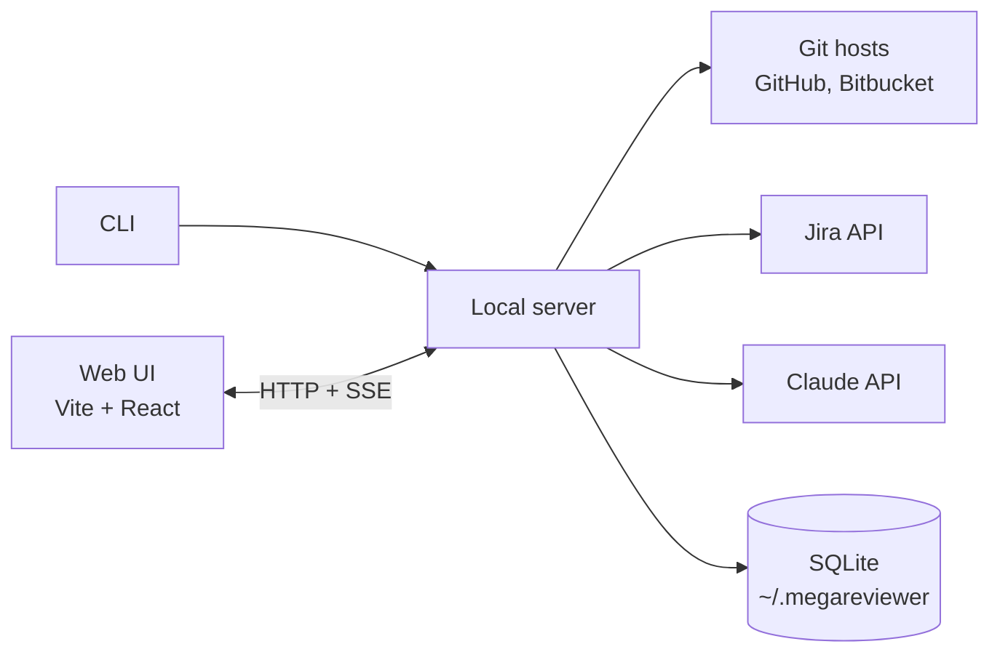

# Architecture

How megareviewer is built. [DESIGN.md](DESIGN.md) covers what it does and why.

## Shape: local-first, no server of ours

megareviewer is a CLI that serves a web UI on the user's machine:

```
npx megareviewer
```

It starts a local server on `127.0.0.1`, opens the browser, and does everything from there. Code, credentials and results never touch infrastructure we run.

Why:

- **Nothing to host or pay for.** Users bring their own Anthropic credentials.
- **Privacy is simple to explain.** "Your code never leaves your machine, except to the model provider" makes security reviews easy.
- **A local process can do what a browser page can't.** It can call Jira and Bitbucket (which block cross-origin browser requests), reuse the `gh` token, read the local git checkout, and later read agent transcripts on disk.

Costs we accept:

- **No shared state between reviewers.** The git host is the shared store: the review is published back to the PR.
- **Each reviewer pays for their own analysis.** A CI step that precomputes it is the later fix.
- **No webhooks,** so analysis starts when the PR is opened in the UI. Results stream so the intent summary shows up first.

## Git hosts

Supported: **GitHub** and **Bitbucket Cloud**.

The pipeline and UI never talk to a host directly. Each host is a connector behind one interface:

| Operation | GitHub | Bitbucket Cloud |
|---|---|---|
| Get PR (title, description, branch, head SHA) | `GET /repos/{o}/{r}/pulls/{n}` | `GET /2.0/repositories/{ws}/{repo}/pullrequests/{id}` |
| Get commits | `.../pulls/{n}/commits` | `.../pullrequests/{id}/commits` |
| Get diff (unified) | `.../pulls/{n}` with diff media type | `.../pullrequests/{id}/diff` |
| Get file at commit | `.../contents/{path}?ref={sha}` | `.../src/{sha}/{path}` |
| List PRs to review | Search API (`review-requested:@me`, `author:@me`) | Per repo, filtered by reviewer and author, across the configured workspace |
| Publish review | One PR review with inline comments and a verdict | Approve or request changes, plus one call per inline comment |

Both hosts return a unified diff, so hunk splitting and everything after it is shared.

Bitbucket specifics:

- **No cross-repo "waiting for my review" search.** The picker scans the repos of the configured workspace. A pasted PR URL always works.
- **Publishing isn't atomic.** Comments are posted one by one, so the server records each posted comment and skips it on retry, avoiding duplicates after a partial failure.

## Components



| Component | Role | Tech |
|---|---|---|
| CLI | Checks credentials, starts the server, opens the browser | Node 24+, TypeScript |
| Local server | Serves the UI and the API, runs the analysis pipeline, holds all credentials | Hono |
| Web UI | PR picker, review page, publishing | Vite, React, Shiki |
| Connectors | Git hosts, tickets, model calls | Octokit, Bitbucket REST, Jira REST, `@anthropic-ai/sdk` |
| Code analysis | Parse changed files for mechanical proofs and call-graph hints | `web-tree-sitter` |
| Store | Cached analyses and review state | SQLite via built-in `node:sqlite`, plain SQL migrations |

It ships as one npm package. The server is bundled into a single file with no runtime dependencies, and the UI is prebuilt and served as static files.

## Why TypeScript everywhere

- **The UI is TypeScript anyway.** Using it for the server too means one language, one toolchain, and one set of Zod schemas shared by the model calls, the server and the UI.
- **The libraries we need are first-class in TypeScript.** Octokit, the Anthropic SDK with Zod helpers, and tree-sitter's WASM build.
- **Easy install.** `npx` works on almost every developer machine with nothing extra to install.

Trade-offs we accept, and how we limit them:

| Trade-off | Mitigation |
|---|---|
| npm supply-chain risk in a tool that holds credentials | The server is bundled at publish time, so users install one package with no dependencies and no third-party install scripts. No native modules (hence `node:sqlite`). Few dependencies (see [ENGINEERING.md](ENGINEERING.md)). |
| Users need Node | Bun can compile the same code into a single binary if that becomes a blocker. |
| Weaker for heavy analysis later | The HTTP API between UI and server is the seam: the server can be rewritten in Go without touching the UI. |

Alternatives considered:

- **Go server + TypeScript UI:** a single binary and a smaller attack surface, but two toolchains and a schema generated for both. We'd switch if security-sensitive buyers or install friction become the blocker.
- **Rust:** no official Claude SDK, and slower iteration that doesn't pay off for mostly-network work.
- **Python:** the hardest to install on users' machines.

## Credentials

| Service | Source | Required |
|---|---|---|
| GitHub | `GITHUB_TOKEN`, else `gh auth token` | For GitHub PRs |
| Bitbucket Cloud | `BITBUCKET_EMAIL` + `BITBUCKET_API_TOKEN` (scoped Atlassian API token), `BITBUCKET_WORKSPACE` for the picker | For Bitbucket PRs |
| Anthropic | SDK default resolution: `ANTHROPIC_API_KEY`, else an `ant auth login` profile | Yes |
| Jira | `JIRA_BASE_URL`, `JIRA_EMAIL`, `JIRA_API_TOKEN` | No. Without it, ticket keys are shown but not fetched |

At least one git host must be configured. Credentials stay in the server process and are never sent to the browser.

## Analysis pipeline

Input is a PR URL from either host. Output is one analysis, cached by `(host, repo, PR, head SHA, pipeline version)`, so reopening a PR is instant and a new push triggers a fresh analysis.

### 1. Collect

- PR title, description, branch name, commits, and the diff, from the host connector.
- Base and head contents of each changed file, for parsing and context.
- Jira tickets: keys matching `[A-Z][A-Z0-9]+-\d+` in the description, commit messages and branch name, fetched from Jira.

### 2. Deterministic prep (no model)

- Split the diff into hunks with stable IDs. Every later stage refers to hunks by ID.
- Mark hunks as **mechanical with proof** when a check proves it:
  - generated or vendored files (lockfiles, `linguist-generated` in `.gitattributes`, known build output);
  - whitespace-only changes;
  - pure renames (rename headers in the diff with no content change);
  - moved code (removed and added blocks match after normalization);
  - formatting-only changes (tree-sitter syntax trees are identical before and after).
- Build call-graph hints with tree-sitter: which changed symbols are defined, and which changed code references them.

The model can't override a mechanical proof. It only classifies the hunks that remain.

### 3. Model passes

All passes use **Claude Opus 5.5** (`claude-opus-5-5`) with structured outputs (Zod schemas) and streaming. They share one cached prompt prefix holding the PR context, so the PR is paid for in full once and read from cache by the later passes. Effort is set per pass.

| Pass | Output | Effort | Runs |
|---|---|---|---|
| Intent | Stated intent (description, tickets), intent inferred from the code, and mismatches between them | medium | First, streamed to the UI |
| Risk | Each remaining hunk marked *logic* or *contract*, with a one-line reason | low | In parallel with Decisions |
| Decisions | Decisions the code makes, each with a category, why it matters, and the hunk IDs it rests on | high | In parallel with Risk |
| Tour | Hunks ordered into concept steps, starting from the entry point, using the call-graph hints | medium | Last, needs Risk and Decisions |

The server validates every response: every referenced hunk ID must exist, and the tour must cover every non-mechanical hunk exactly once. On failure it retries the pass once, then shows the error.

PR content is untrusted. A description or code comment can contain text aimed at the model, so:

- The model has no tools. The worst a prompt injection can do is distort the analysis.
- Model output is rendered as text, never as HTML.
- Mechanical proofs come from deterministic code, not the model.

**Size limits.** Mechanical hunks are sent as path plus stats, not content. If the PR still doesn't fit in the context window, the analysis fails with a clear message. It never silently truncates.

**Cost.** On the order of $1 for a medium PR. This is an estimate, to be measured on real PRs.

## UI

**PR picker.** Lists PRs waiting for the user's review and their own open PRs from every configured host, or accepts a pasted PR URL.

**Review page.**

- **Top:** intent panel showing stated and inferred intent side by side, with mismatches highlighted.
- **Left:** tour steps and the decision checklist. Each decision can be approved, rejected or commented on.
- **Main:** the diff for the current step, with a risk badge on each hunk. Mechanical hunks are collapsed with their proof ("moved, verified identical"), and the user can expand them.

**Publish.** Sends the review to the PR's host with a verdict (approve or request changes). Rejected decisions and comments become inline comments on their hunks. The user confirms before anything is posted.

## Storage

SQLite at `~/.megareviewer/db.sqlite`:

| Table | Holds |
|---|---|
| `analyses` | host, repo, PR number, head SHA, pipeline version, status, result JSON |
| `decision_reviews` | analysis, decision ID, status (pending / approved / rejected), comment |
| `published_comments` | analysis, decision ID, host comment ID, published time |

The pipeline version changes whenever prompts or schemas change, which invalidates cached analyses.

## Local server security

- Binds to `127.0.0.1` only.
- The CLI creates a random session token and opens the UI with it. Every API request must carry the token, and the server checks the `Host` header. This stops other web pages and DNS rebinding from reaching the API.

## First slice

In scope: the CLI, GitHub and Bitbucket Cloud connectors, PR picker, all four model passes, the review page, decision approvals stored locally, and publishing to the host.

Later, in rough order:

1. Read the local git checkout when one exists (full repo context, no API rate limits, other git hosts).
2. Carry decision statuses over when a PR gets new commits.
3. Agent transcripts (e.g. Claude Code sessions) as an intent source.
4. Ask the code (principle 7).
5. A CI step (GitHub Action, Bitbucket Pipelines) that precomputes the analysis and attaches it to the PR.
6. Desktop app via Tauri.
