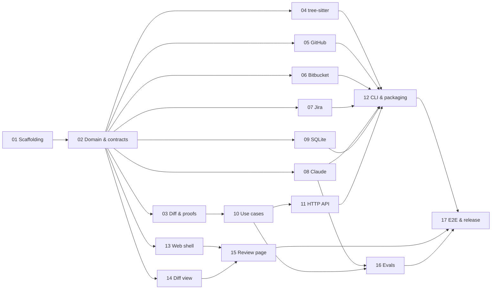

# Implementation plan: first slice

This plan builds the first slice described in [ARCHITECTURE.md](../../ARCHITECTURE.md#first-slice). It is split into stages, each in its own document, so different agents can pick them up in parallel.

The product docs stay the source of truth for *what* and *why*: [MISSION.md](../../MISSION.md), [DESIGN.md](../../DESIGN.md), [ARCHITECTURE.md](../../ARCHITECTURE.md), [ENGINEERING.md](../../ENGINEERING.md). Stage docs say *how*.

## Stages

| # | Stage | Depends on | Owns |
|---|---|---|---|
| 01 | [Scaffolding and tooling](01-scaffolding.md) | — | Root configs, CI, folder skeleton, `src/domain/shared/` |
| 02 | [Domain model, ports and contracts](02-domain-and-contracts.md) | 01 | `src/domain/review/`, `src/domain/diff/types.ts`, `src/domain/shared/hash.ts`, `src/application/ports/`, `src/application/testing/`, `contracts/` |
| 03 | [Diff parsing and mechanical proofs](03-diff-parsing-and-proofs.md) | 02 | `src/domain/diff/` (except S04's files) |
| 04 | [tree-sitter: formatting proofs and call-graph hints](04-tree-sitter.md) | 02 | `src/adapters/treesitter/`, `src/domain/diff/formatting.ts`, `src/domain/diff/call-graph.ts` |
| 05 | [GitHub adapter](05-github-adapter.md) | 02 | `src/adapters/github/` |
| 06 | [Bitbucket Cloud adapter](06-bitbucket-adapter.md) | 02 | `src/adapters/bitbucket/` |
| 07 | [Jira adapter](07-jira-adapter.md) | 02 | `src/adapters/jira/` |
| 08 | [Claude adapter: model passes](08-claude-adapter.md) | 02 | `src/adapters/claude/` |
| 09 | [SQLite store](09-sqlite-store.md) | 02 | `src/adapters/sqlite/` |
| 10 | [Use cases and pipeline](10-use-cases.md) | 02, 03 | `src/application/use-cases/`, `src/application/events/`, `src/domain/review/publication.ts` |
| 11 | [HTTP API](11-http-api.md) | 10 | `src/adapters/http/` |
| 12 | [CLI, composition root and packaging](12-cli-and-packaging.md) | 04–09, 11 | `src/cli/`, `scripts/`, `package.json` bin/files/build |
| 13 | [Web shell, API client and PR picker](13-web-shell.md) | 02 | `web/` (except S14 and S15 folders) |
| 14 | [Diff view component](14-diff-view.md) | 02 | `web/src/diff/` |
| 15 | [Review page and publishing](15-review-page.md) | 13, 14 | `web/src/pages/review/` |
| 16 | [Evals](16-evals.md) | 08, 10 | `evals/` |
| 17 | [End-to-end tests, dogfooding and release](17-e2e-and-release.md) | 12, 15, 16 | `e2e/`, `README.md`, release config |

### Waves

| Wave | Stages | Parallel agents |
|---|---|---|
| 1 | 01 | 1 |
| 2 | 02 | 1 |
| 3 | 03, 04, 05, 06, 07, 08, 09, 13, 14 | up to 9 |
| 4 | 10 (needs 03), 15 (needs 13, 14) | 2 |
| 5 | 11, 16 | 2 |
| 6 | 12 | 1 |
| 7 | 17 | 1 |

Stage 02 is the bottleneck on purpose: it fixes every type, port and API contract so wave 3 can run without agents waiting on each other. Keep it small and finish it fast.

## How to pick up a stage

1. Check the stage doc's **Status** line. Only start a stage that says *Not started* and whose dependencies say *Done*.
2. Set **Status** to `In progress (branch stage/NN-slug)` in a first commit.
3. Work on branch `stage/NN-slug` from the latest `main`.
4. Read the stage doc's **Read first** list. [CLAUDE.md](../../CLAUDE.md) already loads the product docs.
5. Change only paths your stage **Owns**. The exceptions are `package.json` and `pnpm-lock.yaml` when you add a dependency (say why in the PR, per ENGINEERING.md §8). If you need a change elsewhere, see the next section.
6. Open a PR to `main`. You may split a stage into several PRs; each must pass CI.
7. When the last PR merges, set **Status** to `Done (PR links)` and fill **Notes for later stages** with anything that differs from this doc.

## Changing something you don't own

- **Contracts from stage 02** (domain types, ports, `contracts/`, fakes, contract test suites) are shared by everyone. Don't change them silently inside your stage. Open a separate small PR that changes only the contract and its fakes, describe the change and who's affected in the PR, and add a line to stage 02's **Change log**.
- **Anything else:** leave a note in your stage doc's **Notes for later stages** and, if it blocks you, stop and ask the user.
- **If a stage doc is wrong** (an API doesn't behave as described, a type doesn't fit), follow what's right and record the deviation in **Notes for later stages**. Docs describe intent; reality wins.

## Definition of done (every stage)

- `pnpm check` passes locally and in CI: typecheck, lint and format, dependency rules, tests, coverage thresholds.
- Every item in the stage's **Definition of done** is checked.
- The stage changed only paths it owns, plus contract PRs made as described above.
- New decisions that change DESIGN.md or ARCHITECTURE.md are written there in the same PR (ENGINEERING.md §10).
- The PR description states the intent, links the stage doc, and lists decisions made along the way.

## Credentials agents may not have

Some stages need real accounts to record fixtures or run live checks (GitHub, Bitbucket, Jira, Anthropic). If you don't have them:

- Build synthetic fixtures from the official API docs and mark them `synthetic` in the fixture file name.
- Leave the recorder script in place.
- Add an **Open issue** to the stage doc saying which fixtures still need recording.

Never commit tokens, and strip `Authorization` headers and personal data from recorded fixtures.
